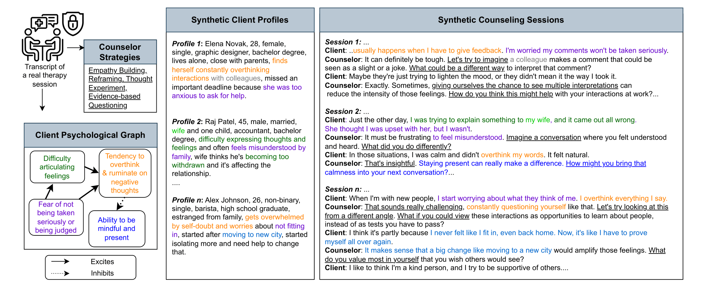

<p  align="center">
  
</p>

# Graph2Counsel: Clinically Grounded Synthetic Counseling Dialogue Generation from Client Psychological Graphs

## Paper and Webpage

📄 [Paper](https://arxiv.org/abs/2604.20382)
<br>
🌐 [Webpage](https://ukplab.github.io/emnlp2026-graph2counsel/)

## Dataset and Model

Our dataset and model can be downloaded [here](https://huggingface.co/collections/UKPLab/graph2counsel). The dataset can also be downloaded at [TUdatalib](https://tudatalib.ulb.tu-darmstadt.de/handle/tudatalib/5071)

## Summary
This codebase provides the scripts used in the experiments of the 2026 Arxiv paper "**Graph2Counsel: Generating Synthetic Counseling Sessions from Client Psychological Graphs**". Here, we generate synthetic counseling session data using Graph2Counsel, a novel framework that grounds session generation in structured psychological representations of clients. Graph2Counsel experiments with three input representations and four prompting techniques. We experiment with the following input representations:
* **Client Psychological Graphs (CPGs):** Structured knowledge graphs encoding relationships among a client's thoughts, emotions, and behaviors, represented as `(process_i, relation, process_j)` triples. CPGs ensure psychological consistency across the generated session.
* **Client Profile:** Diverse client profiles are generated from CPGs to simulate a wide range of backgrounds, presenting issues, and counseling contexts.
* **CPG+Profile:** Use both CPG and client profile.

We experiment with the following prompting technques:
* **Base:** Prompt the LLM to produce the counseling session using the given input.
* **Guided Counseling (GC):** Extract counselor strategies using [paper](https://arxiv.org/abs/2512.05836) and prompt the LLM to produce the counseling session using the extracted counselor strategies and the given input.
* **GC + Chain-of-Thought (GC+CoT):** Prompt the LLM to produce the counseling session using the extracted counselor strategies and the given input while generating reasoning grounded in guidelines, constraints and input for each dialogue turn.
* **GC + Multi-Agent (GC+MA):** Uses two agents with guided counseling. One agent generates an initial session which is critically analyzed by a feedback agent based on guidelines and constraints in the prompts and provides feedback. This feedback is used to regenerate the session.

We find the optimal configuration (combination of input representation and prompting technique) using LLM-as-a-judge evaluation:
* **CTRS:** Cognitive Therapy Rating Scale is a psychological scale used to measure general and CBT-specific counseling skills.
* **WAI:** Working Alliance Inventory measures the therapeutic alliance between the client and the counselor.

Once the optimal configuration is found we use the following evaluations:
* **Faithfulness:** Measures how faithfully the generated session reflects the input CPG in terms of the client's thoughts, emotions, and behaviors.
* **Downstream Evaluation:** We QLoRA fine-tune an open source model (Llama3-8B-Instruct in our case) and evaluate them on [CounselBench](https://arxiv.org/abs/2506.08584) and [CounselingBench](https://aclanthology.org/2025.findings-naacl.418/)
* **Therapy-Eval:** A multi-turn evaluation framework that simulates realistic counseling sessions between a Llama3-8B-Instruct client agent (role-played from 100 character cards sampled from [Eeyore](https://arxiv.org/abs/2306.09742)) and each fine-tuned counselor model, then scores the resulting sessions with GPT-4o as an LLM judge on specificity, authenticity, counselor competence, conversational flow, and safety.

> **Abstract:** Rising demand for mental health support has increased interest in using Large Language Models (LLMs) for counseling, but adapting them to this safety-critical domain is hindered by limited real-world data due to privacy constraints. Synthetic datasets provide a promising alternative, but existing approaches often rely on unstructured or semi-structured text inputs and overlook structural dependencies between a client's cognitive, emotional, and behavioral states, leading to psychologically inconsistent and less realistic interactions. We introduce Graph2Counsel, a framework for generating synthetic counseling sessions grounded in Client Psychological Graphs (CPGs) that encode relationships among clients’ thoughts, emotions, and behaviors. Graph2Counsel uses a structured prompting pipeline guided by counselor strategies and CPG, and explores prompting strategies including CoT and Multi-Agent Feedback. It produces 760 sessions from 76 CPGs across diverse client profiles. In expert evaluation, our dataset outperforms prior datasets on specificity, counselor competence, authenticity, conversational flow, and safety (Krippendorff's $\alpha$ = 0.70). Fine-tuning an open-source model on this dataset improves performance on several metrics on CounselingBench and CounselBench, while matching baselines on others. We further introduce Therapy-Eval, a multi-turn evaluation framework, and demonstrate the effectiveness of our fine-tuned model in realistic therapeutic conversations.

Contact person: [Aishik Mandal](mailto:aishik.mandal@tu-darmstadt.de) 

[UKP Lab](https://www.ukp.tu-darmstadt.de/) | [TU Darmstadt](https://www.tu-darmstadt.de/
)

Don't hesitate to send us an e-mail or report an issue, if something is broken (and it shouldn't be) or if you have further questions.

## Creating the environment

To create the environment for Inference and Evaluation (i.e. run scripts in folder src/ and evaluation/) use:

```
python3 -m venv inf_env
source inf_env/bin/activate
pip install -r requirements_inf_eval.txt
```

To create the environment for Qlora Fine-tuning (i.e. run scripts in folder qlora/) use:

```
python3 -m venv qlora_env
source qlora_env/bin/activate
pip install -r requirements_qlora.txt
```

## Repository Structure
```
graph2counsel/
│
├── prompts_system_user/                  # System and user prompts used in configurations and client_profile_generation
│
├── Graph_Dicts.ipynb                     # Build KG triples from CPGs
│
├── client_profile_generation/            # Scripts for generating client profiles
│
├── therapist_strategies_summary.csv      # csv file containing extracted counselor strategies from real counseling sessions
│
├── configurations/                       # Generation configuration experiments
│   └── gc_cpg_profile_expanded.py        # Final dataset generation (GC CPG+Profile optimal config)
│
├── LLM_judge_evaluation/                 # CTRS and WAI evaluation with LLM-as-a-judge
│
├── faithfulness_evaluation/              # Faithfulness of sessions to CPG and profile inputs
│
├── qlora_prompts/                        # Prompts used for QLoRA fine-tuning
│
├── create_qlora_fine-tuning_datasets.ipynb  # Prepare datasets for QLoRA
│
│── graph2counsel_qlora.py                # Fine-tune on Graph2Counsel data
│── sqpconv_qlora.py                      # Fine-tune on SQPsychConv data
│── magnet_qlora.py                       # Fine-tune on MAGneT data
│
├── CounselBench/                         # Downstream evaluation on CounselBench
├── CounselingBench/                      # Downstream evaluation on CounselingBench
├── Therapy-Eval/                         # LLM-as-a-judge eval of fine-tuned models on realistic multi-turn role-play conversations
│
├── requirements_inf_eval.txt             # Dependencies for inference & evaluation
└── requirements_qlora.txt                # Dependencies for QLoRA fine-tuning
```

## Downloading Data

| Dataset | Link |
|---|---|
| **Graph2Counsel** (ours) | [HuggingFace](https://huggingface.co/datasets/UKPLab/Graph2Counsel)/[TUdatalib](https://tudatalib.ulb.tu-darmstadt.de/handle/tudatalib/5071) |
| **SQPsychConv** (We use Gemma split) | [HuggingFace](https://huggingface.co/collections/AIMH/sqpsychconv) |
| **CACTUS** | [HuggingFace](https://huggingface.co/datasets/LangAGI-Lab/cactus) |
| **MAGneT** | [HuggingFace](https://huggingface.co/datasets/UKPLab/MAGneT)/[TUdatalib](https://tudatalib.ulb.tu-darmstadt.de/handle/tudatalib/5072) |
| **CounselBench-Eval** | [HuggingFace](https://huggingface.co/datasets/izi-ano/CounselBench-Eval) |
| **CounselBench-Adv** | [HuggingFace](https://huggingface.co/datasets/izi-ano/CounselBench-Adv) |
| **CounselingBench** | [HuggingFace](https://huggingface.co/datasets/ckmjx/CounselingBench) |
| **Eeyore** | [HuggingFace](https://huggingface.co/datasets/liusiyang/eeyore_profile) |

Place CounselBench data in the `CounselBench/` directory and CounselingBench data in `CounselingBench/`.

## Reproducing Experiments

Follow these steps in order after setting up your environment and downloading data.

**1. Build CPG Representations**

Run `Graph_Dicts.ipynb` to create `(process_i, relation, process_j)` KG triples from the CPGs. Outputs are saved to `CPG_processed/`.

**2. Generate Client Profiles**

See `client_profile_generation/` for instructions and scripts.

**3. Extract Counselor Strategies**

Follow this [paper](https://arxiv.org/abs/2512.05836) to extract counselor strategies.

**4. Run Configuration Experiments**

Use files in `configurations/` to experiment with different generation strategies. See the folder README for details. We found the **GC (CPG + Profile)** configuration to be optimal.

**5. Evaluate Generated Sessions**

Use files in `LLM_judge_evaluation/` to score sessions on CTRS and WAI metrics using LLM-as-a-judge. See the folder README for details.

**6. Generate the Final Dataset**

Using the optimal configuration:
```bash
python configurations/gc_cpg_profile_expanded.py
```

**7. Evaluate Faithfulness**

Use files in `faithfulness_evaluation/` to assess how faithfully generated sessions reflect their CPG and profile inputs.

**8. Prepare Fine-tuning Datasets**

Run `create_qlora_fine-tuning_datasets.ipynb`, updating dataset paths to match your download locations.

**9. Run QLoRA Fine-tuning**

Update the base model path and output model path in the relevant script (we used `Llama3-8B-Instruct`), then run:
```bash
deepspeed --num_gpus=num_gpus qlora/graph2counsel_qlora.py
deepspeed --num_gpus=num_gpus qlora/sqpconv_qlora.py
deepspeed --num_gpus=num_gpus qlora/magnet_qlora.py
```

**10. Downstream Evaluation**

Use scripts in `CounselBench/` and `CounselingBench/` for benchmark evaluation. See each folder for details.

**11. Therapy-Eval**

Use `Therapy-Eval/generate-sessions.py` to role-play sessions between a Llama3-8B-Instruct client agent and each fine-tuned counselor checkpoint, then score them with `Therapy-Eval/therapy-eval-gpt4o.py` on specificity, authenticity, competence, flow, and safety. See the folder for details.

## Cite

Please use the following citation:

```
@inproceedings{mandal-etal-2026-graph2counsel,
    title = "{G}raph2{C}ounsel: Clinically Grounded Synthetic Counseling Dialogue Generation from Client Psychological Graphs",
    author = "Mandal, Aishik  and
      Arnaout, Hiba  and
      Ong, Clarissa W.  and
      Bockhorst, Juliet  and
      Sheehan, Kate  and
      Moldow, Rachael  and
      Chakraborty, Tanmoy  and
      Gurevych, Iryna",
    editor = "Lee, Hung-Yi  and
      Dev, Sunipa  and
      Li, Junyi Jessy  and
      Elliott, Desmond",
    booktitle = "Proceedings of the 2026 Conference on Empirical Methods in Natural Language Processing",
    month = oct,
    year = "2026",
    address = "Budapest, Hungary",
    publisher = "Association for Computational Linguistics",
    url = "https://aclanthology.org/2026.emnlp-main.85/",
    doi = "10.18653/2026.emnlp-main.85",
    pages = "1953--2012",
    ISBN = "979-8-89176-459-0",
    abstract = "Rising demand for mental health support has increased interest in using Large Language Models (LLMs) for counseling, but adapting them to this safety-critical domain is hindered by limited real-world data due to privacy constraints. Synthetic datasets provide a promising alternative, but existing approaches often rely on unstructured or semi-structured text inputs and overlook structural dependencies between a client{'}s cognitive, emotional, and behavioral states, leading to psychologically inconsistent and less realistic interactions. We introduce Graph2Counsel, a framework for generating synthetic counseling sessions grounded in Client Psychological Graphs (CPGs) that encode relationships among clients' thoughts, emotions, and behaviors. Graph2Counsel uses a structured prompting pipeline guided by counselor strategies and CPG, and explores prompting strategies including CoT and Multi-Agent Feedback. It produces 760 sessions from 76 CPGs across diverse client profiles. In expert evaluation, our dataset outperforms prior datasets on specificity, counselor competence, authenticity, conversational flow, and safety (Krippendorff{'}s $\alpha$ = 0.70). Fine-tuning an open-source model on this dataset improves performance on several metrics on CounselingBench and CounselBench, while matching baselines on others. We further introduce Therapy-Eval, a multi-turn evaluation framework, and demonstrate the effectiveness of our fine-tuned model in realistic therapeutic conversations. We make our code, data and fine-tuned model public."
}
```

## References/Libraries

- [DeepSpeed](https://www.deepspeed.ai/)
- [vLLM](https://docs.vllm.ai/en/latest/)
- [HuggingFace](https://huggingface.co/)
- [LangChain](https://www.langchain.com/)
- [CACTUS](https://aclanthology.org/2024.findings-emnlp.832/)
- [SQPsychConv](https://arxiv.org/abs/2510.25384)
- [MAGneT](https://arxiv.org/abs/2509.04183)
- [CounselBench](https://arxiv.org/abs/2506.08584)
- [CounselingBench](https://aclanthology.org/2025.findings-naacl.418/)
- [Eeyore](https://aclanthology.org/2025.findings-acl.707/)

## Disclaimer

> This repository contains experimental software and is published for the sole purpose of giving additional background details on the respective publication. 
